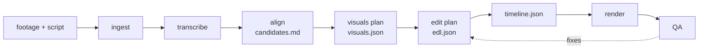

<div align="center">

# open-video-brain

**Footage and a script in, a finished YouTube video out.**

open-video-brain turns raw footage and a script into an edited YouTube video: longform episodes (16:9) and Shorts (9:16), with graphics, captions, sound design, subtitles and chapter marks. [Claude Code](https://code.claude.com/docs) makes the editing decisions and writes them down as JSON. Node scripts and [Remotion](https://www.remotion.dev) do everything mechanical. It runs on your machine, in your own brand.

[](LICENSE)
[](https://www.remotion.dev)
[](https://code.claude.com/docs)
[](https://www.typescriptlang.org)
[](#contributing)

[Quick start](#quick-start) · [How it works](#how-it-works) · [Commands](#commands) · [Skills](#skills-and-agents) · [Your brand](#make-it-your-own-brand) · [Contributing](#contributing)

</div>

---

## Why

Editing a talking-head video is mostly decisions: which take, where to cut, when a graphic helps, what it should say. The rest is mechanical work on frames, timecodes and audio levels. An agent is good at the first part and unreliable at the second. open-video-brain splits the two: Claude reads the transcript and the script and decides; scripts execute those decisions the same way every time.

- **Claude decides, scripts execute.** Every decision lands in `work/edl.json`. Claude never touches frames or audio directly, and never invents a timecode: source times come from the transcript.
- **One pipeline, two formats.** Longform episodes and Shorts come from the same footage, the same components and the same rules.
- **Brand components only.** Graphics come from a component library with a schema and usage rules per component. No one-off colors, fonts or animations per video.
- **A house style that learns.** `CLAUDE.md` holds the editing rules (when to split the screen, hold times, sound levels, Shorts pacing). After each review, your objections are recorded there as dated rules.
- **Costs stay visible.** Transcripts and voice inserts are cached, and Claude asks before each paid action.

What you get per video: the `.mp4`, `.srt` subtitles, YouTube chapter marks, a QA contact sheet and a report of what was cut and what is still missing.

## Quick start

You need macOS or Linux, Node.js 20.6 or newer, ffmpeg with ffprobe, and [Claude Code](https://code.claude.com/docs). The face track for Shorts (`npm run faces`) is macOS only.

```bash
git clone https://github.com/kuehlpaul/open-video-brain.git
cd open-video-brain
bash setup.sh        # installs dependencies, creates .env, checks the toolchain
```

### Try the demo without API keys

The demo project ships with synthetic footage and a transcript, so it needs no keys.

```bash
npm run timeline -- _demo
npm run render -- _demo --draft     # → projects/_demo/work/render/_demo-draft.mp4
```

`npm run timeline` warns that the sound `click` is missing. That is expected: `brand/sfx/` starts empty, and a missing sound is skipped.

### Make your first video

Add your [ElevenLabs](https://elevenlabs.io) key to `.env` (it transcribes the footage), then:

```bash
npm run doctor                                   # checks machine, tools and keys
claude                                           # then type /welcome – sets up your brand
npm run new -- my-video --title "My first video"
# copy footage to   projects/my-video/longform/input/footage/
# write the script  projects/my-video/longform/input/script.md
claude
> /produce-video my-video
```

Claude transcribes, finds the best takes, plans visuals and the edit, renders a draft, checks it, fixes what it finds and renders the final. The results land in the project's `output/` folder. Script conventions are in `projects/_template/input/script.md`. Headless: `claude -p "/produce-video my-video"`.

## How it works



| Step | Who | Result |
|---|---|---|
| Ingest, transcribe | script | `work/footage.json`, word-level transcripts |
| Find takes | script | `work/candidates.md`: the takes per script sentence |
| Photo or graphic per beat | Claude (`/visuals-plan`), then script | `work/visuals.json`, media in `work/assets/` |
| Plan the edit | Claude (`/edit-plan`) | `work/edl.json`: takes, order, graphics, cues, sounds, music |
| Build the timeline | script | `work/timeline.json`: frame-accurate cut, pauses tightened, zooms and whooshes set |
| Render | Remotion | draft or final video, loudness normalized to −14 LUFS |
| Check | script + Claude (`/qa-check`) | `work/qa/report.md`, contact sheet, fixes back into the EDL |

What the edit looks like:

- Speaker shots alternate between wide and punched-in, **split screens** put a graphic next to the speaker, **fullscreen** shows B-roll and full-frame graphics.
- 19 animated components (lists, tiles, bars, columns, comparisons, statements, flows, calendar, photo, video, end card and more), each cued to the spoken word.
- Shorts get karaoke captions and a face track that keeps the speaker centered.
- Sound design: whooshes on layout changes, clicks, chapter impacts, a music bed, optional voice isolation.

## Commands

All commands take the project slug: `npm run <command> -- <slug>`.

| Command | What it does |
|---|---|
| `npm run new -- <slug> [--format short] [--source <longform>]` | Create a project |
| `npm run ingest` · `transcribe` · `align` | Read the footage, transcribe it, find the takes per script sentence |
| `npm run visuals -- <slug> [--search] [--pick <beat>:<nr>]` | Search and pick photos and clips for the visuals plan |
| `npm run sounds -- <slug> --query "<words>" [--kind sfx\|music]` | Search freely licensed sounds and music |
| `npm run capture -- <slug> --url <url> --name <name>` | Record a website as B-roll (local, no key) |
| `npm run upscale -- <slug> --pick <beat>:<nr>` | Upscale a photo that is too small (paid) |
| `npm run generate -- <slug> --type image\|video\|audio …` | Generate an asset with AI (paid) |
| `npm run voice` · `audio [--isolate]` | Voice inserts, audio polish, optional voice isolation (paid) |
| `npm run faces` | Face track for Shorts (macOS) |
| `npm run timeline` | Build `work/timeline.json` from the EDL |
| `npm run music` | Generate music at the exact length of a Short (paid) |
| `npm run render -- <slug> [--draft]` | Render the draft or the final video |
| `npm run qa -- <slug> [--draft]` | Automatic checks and the contact sheet |
| `npm run preview -- <slug>` · `studio` · `catalog` | Preview a project, browse components, render component stills |
| `npm run brand -- --name … --accent …` | Apply your brand basics |
| `npm run doctor` | Check machine, tools and keys |

## Skills and agents

Everything lives in `.claude/` and is picked up when you run `claude` in the repo.

| Skill | What it does |
|---|---|
| `/welcome` | Onboarding: channel name, language, accent color, logo, avatar, font; then the first project |
| `/produce-video <slug>` | The whole pipeline, autonomously, with a report |
| `/shorts-cutdown <longform-slug>` | Finds and cuts 3–7 Shorts from a longform |
| `/visuals-plan` | Decides photo, video or graphic per beat and sources the media |
| `/edit-plan` | Writes `work/edl.json` |
| `/qa-check <slug>` | Automatic checks plus a visual check against the house style |
| `/voice-insert` | Narration with an ElevenLabs voice clone (consent required) |
| `/generate-asset` | AI image, video clip or sound effect when no footage exists |
| `/new-component` | Builds a new graphic component in the house style |

| Agent | Role |
|---|---|
| `editor` | Writes and revises the EDL |
| `qa-reviewer` | Independent, read-only review of a rendered video |
| `motion-designer` | Builds and changes components |

`.claude/settings.json` allows the npm scripts and ffmpeg, asks before paid actions and blocks access to `.env`.

Optional, recommended for component work: Remotion's own skill.

```bash
npx skills add remotion-dev/skills --skill remotion-best-practices
```

## Configuration

API keys go into `.env` (`cp .env.example .env`; `setup.sh` does this for you). Only ElevenLabs is needed for your own videos, everything else is optional.

| Service | Variable | Used for |
|---|---|---|
| [ElevenLabs](https://elevenlabs.io) | `ELEVENLABS_API_KEY` | Transcription, voice isolation, voice inserts, music and sound generation |
| [fal.ai](https://fal.ai), [Black Forest Labs](https://bfl.ai), [Higgsfield](https://higgsfield.ai), [Atlas Cloud](https://www.atlascloud.ai) | `FAL_KEY`, `BFL_API_KEY`, `HIGGSFIELD_API_KEY`, `ATLAS_API_KEY` | Generated images and clips. One is enough; pick with `--provider` |
| [Pexels](https://www.pexels.com/api/), [Pixabay](https://pixabay.com/api/docs/), [Unsplash](https://unsplash.com/developers), [Coverr](https://api.coverr.co/docs) | `PEXELS_API_KEY`, `PIXABAY_API_KEY`, `UNSPLASH_ACCESS_KEY`, `COVERR_API_KEY` | Stock photo and video search |
| [Freesound](https://freesound.org/docs/api/) | `FREESOUND_API_KEY` | Sound effect search |
| [Magnific](https://magnific.com/api) | `MAGNIFIC_API_KEY` | Upscaling small photos |
| [Remotion](https://www.remotion.pro/license) | `REMOTION_LICENSE_KEY` | Company license, required for companies with 4 or more people |

Wikimedia Commons, Openverse and the NASA Image and Video Library are searched without a key.

### Costs

- Transcripts and voice inserts are cached; re-running costs nothing. Use `--force` only when you need to.
- Voice isolation (per minute), text-to-speech (per character), music and image or video generation are billed by the providers. Video generation is the most expensive item.
- `.claude/settings.json` makes Claude ask before each paid action.

## Make it your own brand

The repo ships with an example brand: light surfaces, one blue accent, placeholder logo. `/welcome` in Claude Code asks for the basics and applies them with `npm run brand`. Everything else by hand:

| Where | What |
|---|---|
| `brand/brand.json` | Colors (the accent is `look.brand`), typography, split layout, pacing, caption style, sound levels, loudness targets |
| `brand/logos/` | Your logo files. Keep the file names |
| `brand/fonts/` | Starts empty. Drop in your font files and set `typography.family`; they load automatically. Without files, the family is used if it is installed on your system |
| `brand/sfx/` | Starts empty. Drop in your sounds; the file name is the name in `edl.json`. The names the pipeline looks for are in `brand/sfx/README.md` |
| `remotion/components/` | The graphics. Browse them with `npm run studio`, add new ones with `/new-component` |
| `CLAUDE.md` | The house style and the learnings from your reviews |

Fonts and sounds are not included; you bring your own. Details: [brand/README.md](brand/README.md).

## Development

```bash
npm install
npm run typecheck
npm run timeline -- _demo && npm run render -- _demo --draft
```

| Script | What it does |
|---|---|
| `npm run typecheck` | `tsc --noEmit` |
| `npm run gen` | Regenerates the component registry and `CATALOG.md` |
| `npm run studio` | Remotion Studio with all components |
| `npm run catalog` | Renders a still of every component to `brand/catalog/` |
| `npm run doctor` | Checks machine, tools and keys |

### Project layout

```
CLAUDE.md        Rules for Claude: golden rules, workflow, house style, learnings
.claude/         Skills, agents, permissions
brand/           brand.json, logos, voices; fonts/ and sfx/ for your own files
pipeline/        CLI scripts for every step, schemas in pipeline/schemas/
remotion/
  Main.tsx       Composes speaker, graphics and sound
  look/          The house style as building blocks, fed from brand.json
  lib/           Layouts (16:9 and 9:16), fonts, brand files
  components/    One folder per graphic: def.ts, <Name>.tsx, meta.md
projects/        One folder per video; _template/, _library/, _demo/, _demo-short/
```

## Contributing

Issues and pull requests are welcome. See [CONTRIBUTING.md](CONTRIBUTING.md) for the details.

1. Fork the repo and create a branch from `main`.
2. Run `npm run typecheck` and render the demo before opening a PR.
3. New graphics go into `remotion/components/` and are built from `remotion/look/`. Run `npm run gen` afterwards.
4. Rules in `CLAUDE.md` and `.claude/` stay generic: nothing that only fits one video or one brand.
5. Never commit `.env`, API keys, footage or rendered videos.

For larger changes, open an issue first so we can discuss the approach.

## License

[MIT](LICENSE) © 2026 Paul Kühl

Remotion is not MIT. It is free for individuals and companies with up to 3 people; larger companies need a [Remotion company license](https://www.remotion.pro/license). Fonts, sounds, music and stock media you add keep their own licenses.
